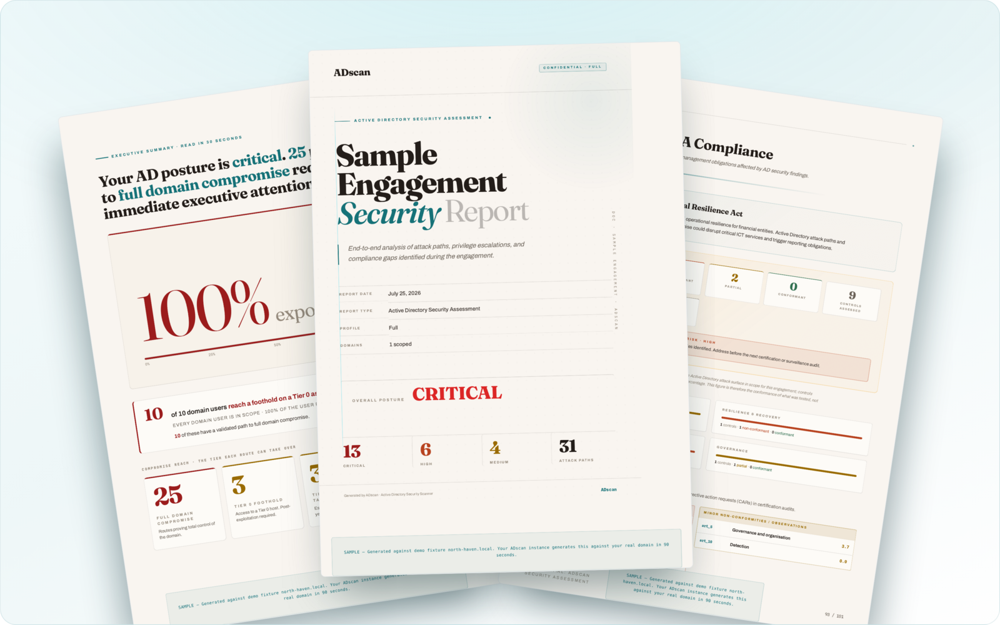

<div align="center">


# ADscan - Active Directory Pentesting Tool for Linux, macOS and Windows

[](https://pypi.org/project/adscan/)
[](https://pepy.tech/projects/adscan)
[](https://github.com/ADscanPro/adscan/stargazers)
[](https://github.com/ADscanPro/adscan/blob/main/LICENSE)
[](https://github.com/ADscanPro/adscan)

**Free Active Directory pentesting CLI for pentesters, red teamers and security consultants. Recon, Kerberoasting, ADCS and DCSync in one terminal, with the attack path to Domain Admin mapped as you go.**

**[Quick start](#quick-start)** | **[Docs](https://adscanpro.com/go/gh-docs)** | **[HTB Forest walkthrough](https://adscanpro.com/go/gh-forest)** | [Sample client report](https://adscanpro.com/go/gh-sample) | [Free first PRO assessment for firms](https://adscanpro.com/go/gh-pro) | [Discord](https://discord.com/invite/fXBR3P8H74)

</div>

ADscan covers <!-- adscan:figure technique_count -->108<!-- /adscan:figure --> Active Directory attack techniques in a single workflow, from unauthenticated recon to AS-REP roasting, ADCS/ESC exploitation, credential harvesting and native attack-path analysis. It is free and source-available under the Business Source License 1.1.

```bash
pipx install adscan   # Linux or macOS, with Docker running
adscan install        # pulls the runtime image, needs 15 GB free
adscan start          # then type start_unauth
```

On Windows there is nothing to install. Download `adscan.exe` from the [latest release](https://github.com/ADScanPro/adscan/releases/latest) and run it, no Docker and no Python needed. The [Quick Start](#quick-start) below has the details.

[](https://asciinema.org/a/734180?autoplay=1)

_A real run with no cuts. ADscan takes **HTB Forest** from zero access to Domain Admin in about 3 minutes, unattended._

---

## Table of Contents

- [Quick Start](#quick-start)
- [ADscan vs Alternatives](#adscan-vs-alternatives)
- [Kerberoasting, ADCS and AD Attack Coverage](#kerberoasting-adcs-and-ad-attack-coverage)
- [Common Pentest Workflows](#common-pentest-workflows)
- [Usage Examples](#usage-examples)
- [Want the Full Client Report?](#want-the-full-client-report)
- [Requirements](#requirements)
- [FAQ](#faq)
- [Developer Setup](#developer-setup)
- [Contributing](#contributing)
- [Author](#author)
- [License](#license)

---

## Quick Start

**On Linux or macOS**, ADscan runs inside Docker, so you need **Docker Engine installed and running**, and about **12 GB of free disk** for the runtime image (the installer requires 15 GB free before it will pull).

```bash
docker version   # if this fails, install Docker first
pipx install adscan
adscan install
adscan start
```

**On Windows** there is no Docker and no Python to install. Download `adscan.exe` from the [latest GitHub release](https://github.com/ADScanPro/adscan/releases/latest), unblock it once (`Unblock-File .\adscan.exe` in PowerShell) and run it. It is one self-contained file that carries its own runtime and tools, so it works on a hardened, locked-down host. That is the usual assumed-breach scope, where your only foothold is a domain-joined Windows box.

> The [installation guide](https://adscanpro.com/go/gh-install) has Docker install steps for each distribution and the full Windows walkthrough.

Once inside the shell, start an unauthenticated recon:

```
(ADscan) > start_unauth
```

This discovers domain controllers, SMB exposure, null sessions, and roastable accounts without credentials. From there, run `start_auth` with a domain user to enumerate LDAP, collect BloodHound data, and build the attack graph.

### One command instead of the shell (PRO)

`adscan ci` runs the whole pipeline non-interactively: preflight, recon, enumeration, exploitation, reporting, no prompts. Same engine, no shell. It is a **PRO** capability, because automation and unattended runs are what you pay for. The free LITE tier gives you the full interactive `adscan start` shell on every platform.

```bash
# Authenticated scan of a domain, under the Audit built-in policy
adscan ci auth --policy audit --interface eth0 \
  --domain corp.local --dc-ip 10.0.0.1 -u alice -p 'S3cr3t!'

# Unauthenticated sweep of a lab
adscan ci unauth --policy lab_ctf --interface eth0 --dc-ip 10.0.0.1
```

The `auth`/`unauth` positional and `--policy` are required. The scan policy decides what runs and the scan pace: `lab_ctf`, `audit`, `production_sensitive`, or one you saved (`adscan policy list`, `adscan policy create`). `--pacing` and `--pace-profile` are optional; without them the run uses the policy's own pace. `adscan ci --help` lists the rest.

`adscan ci` makes every decision the interactive shell would ask you about, so it's built for pipelines, lab automation, and unattended engagement runs. For client work where you want to review each decision, the interactive `adscan start` shell (free on LITE) is the supported path.

---

## ADscan vs Alternatives

Most AD pentesters use 5-8 separate tools. ADscan replaces the chain:

| | ADscan | NetExec/CrackMapExec | Certipy | Impacket | BloodHound CE |
|---|---|---|---|---|---|
| **Platform** | Linux/Win | Linux/Win | Linux | Linux | Linux/Win |
| **AD enumeration** | Full | Partial | No | Partial | No |
| **Kerberoasting** | Yes | Yes | No | Yes | No |
| **AD CS <!-- adscan:figure adcs_esc_span -->ESC1–ESC17<!-- /adscan:figure -->** | Yes (<!-- adscan:figure adcs_esc_executed_count -->13<!-- /adscan:figure --> auto, <!-- adscan:figure adcs_esc_detected_only_count -->4<!-- /adscan:figure --> detected) | No | Yes (manual) | No | No |
| **Attack paths** | Native graph | No | No | No | Yes |
| **DCSync** | Yes | Yes | No | Yes | No |
| **Single workflow** | Yes | No | No | No | No |
| **Compliance reports** | PRO tier | No | No | No | No |

ADscan is not a replacement for every tool in every scenario. It is the fastest path from credentials to a documented attack chain in a single terminal session.

---

## Kerberoasting, ADCS and AD Attack Coverage

ADscan covers <!-- adscan:figure technique_count -->108<!-- /adscan:figure --> Active Directory attack techniques across the kill chain, <!-- adscan:figure supported_technique_count -->69<!-- /adscan:figure --> of them executed end to end. The [full technique coverage table](COVERAGE.md) lists every one, generated from the product catalog and mapped to MITRE ATT&CK.

<table>
<tr>
<td width="50%">

### LITE (Free, Source Available)

**Everything a pentester could do manually, without the toolchain:**
- Two operation modes: automatic (runs the flow end-to-end) and semi-automatic (pauses for operator approval at decision points)
- DNS, LDAP, SMB, Kerberos enumeration
- AS-REP Roasting and Kerberoasting
- Password spraying
- Native graph collection and attack-path analysis
- Credential harvesting (SAM, LSA, DCSync)
- ADCS detection and template enumeration
- GPP passwords and CVE enumeration
- Export to TXT/JSON
- Workspace and evidence management

</td>
<td width="50%">

### PRO

**What takes days manually, automated:**
- Algorithmic attack graph generation
- Auto-exploitation chains (unauthenticated to Domain Admin)
- AD CS auto-exploitation of <!-- adscan:figure adcs_esc_executed -->ESC1–ESC9, ESC11, ESC13–ESC15<!-- /adscan:figure --> (<!-- adscan:figure adcs_esc_detected_only -->ESC10, ESC12, ESC16–ESC17<!-- /adscan:figure --> detected and mapped)
- MITRE-mapped PDF reports
- Multi-domain trust spidering
- Advanced privilege escalation chains
- Priority enterprise support

[Full comparison](https://adscanpro.com/go/gh-compare) | [Free first PRO assessment for firms](https://adscanpro.com/go/gh-pro-table)

</td>
</tr>
</table>

---

## Common Pentest Workflows

- **CTF and lab auto-pwn:** reproduce HTB Forest, Active, and Cicada attack chains from the docs.
- **Unauthenticated AD recon:** discover domains, DNS, SMB exposure, null sessions, users, and roastable accounts.
- **Authenticated enumeration:** collect LDAP, SMB, Kerberos, ADCS, attack-graph data, and credential exposure.
- **Privilege escalation:** execute Kerberoasting, AS-REP Roasting, DCSync, GPP password, ADCS, and local credential workflows.
- **Evidence handling:** keep workspaces isolated and export findings to TXT/JSON for reports.

---

## Usage Examples

**Unauthenticated recon:**

```bash
adscan start
# Inside the ADscan shell:
start_unauth
```

Discovers domain controllers, DNS, SMB null sessions, and roastable accounts without credentials.

**Authenticated scan with BloodHound collection:**

```bash
# Inside the ADscan shell (after start_auth):
start_auth
```

Collects LDAP data, builds the attack graph, and identifies Kerberoasting targets, ADCS misconfigurations, and privilege escalation paths.

More walkthroughs:

- [HTB Forest auto-pwn](https://adscanpro.com/go/gh-lab-forest)
- [HTB Active walkthrough](https://adscanpro.com/go/gh-lab-active)
- [HTB Cicada walkthrough](https://adscanpro.com/go/gh-lab-cicada)

---

## Want the Full Client Report?

<a href="https://adscanpro.com/go/gh-report">
  
</a>

The PRO deliverable is an audit-ready PDF an executive and a sysadmin can both act on: a posture score, attack-path analysis, and per-framework compliance mapping. The pages above come from a sample engagement against a lab domain.

ADscan LITE gives you enumeration, attack paths, and findings in the terminal. **ADscan PRO** turns them into three client-ready PDFs in 90 seconds:

- **Security Assessment Report:** the risk narrative, attack chains, and posture score a CISO and board can act on
- **AD Hardening Playbook:** a 30-day remediation roadmap with effort and ownership per item
- **AD Control Coverage Report:** your findings mapped to <!-- adscan:figure framework_list -->ENS, NIS2, ISO 27001, DORA, PCI DSS and CIS Benchmark<!-- /adscan:figure --> for the auditor

Your first PRO assessment is free for a consultancy with a dated client engagement. [Request it at adscanpro.com/pro](https://adscanpro.com/go/gh-pro-report)

---

## Requirements

| | |
|---|---|
| **OS** | Linux (Debian/Ubuntu/Kali/Parrot) or macOS with Docker Desktop; or Windows via the native self-contained bundle (no Docker, no Python) |
| **Docker** | Required on Linux/macOS (Docker Engine; Compose is no longer needed). Not used by the Windows bundle |
| **Disk** | Linux/macOS: 15 GB free before install, runtime image roughly 12 GB unpacked. Windows bundle: a few hundred MB |
| **Privileges** | Linux/macOS: `docker` group or `sudo`. Windows: runs as a normal domain user, no local admin required |
| **Network** | Internet to pull the image or download the bundle, plus the target network |

---

## FAQ

### Does ADscan work without a Windows machine?

Yes. On Linux (or macOS) ADscan runs entirely inside Docker. No Windows VM, no RDP, no agent installation required. It connects to your target AD environment over the network using standard protocols (LDAP, SMB, Kerberos).

### Does ADscan run natively on Windows?

Yes. `adscan.exe` from the latest GitHub release is a self-contained Windows build. It needs no Docker, no Python install and no local admin. It carries its own runtime and tools, so it works on a hardened, locked-down host, which is the usual assumed-breach scope where your only foothold is a domain-joined Windows box. The same engine runs on both platforms; only the packaging differs. On Windows without a GPU, password cracking falls back to CPU automatically, and the port scan runs in-process (no Npcap driver needed).

### Is ADscan safe to run in production Active Directory environments?

ADscan LITE is read-only by default for enumeration. Exploitation steps (Kerberoasting, credential dumping, DCSync) require explicit operator confirmation. Run it in a test window with your client's written authorization. See the [security policy](SECURITY.md) for responsible use guidelines.

### How is ADscan different from BloodHound?

BloodHound is a graph analysis tool that requires separate data collection (SharpHound or AzureHound). ADscan collects data, builds the attack graph, and executes the attack chain from one terminal. LITE includes native graph collection compatible with BloodHound CE. PRO adds algorithmic attack path auto-exploitation.

### Is ADscan open source?

No. ADscan is free and source-available under the [Business Source License 1.1](LICENSE), which is not an OSI-approved open-source license. You can read, modify and redistribute the code, and use it at no cost on your own pentests, paid client work included. What the license rules out is offering ADscan to third parties as a hosted or embedded product that competes with the paid version. Each version converts to Apache 2.0 on its Change Date, 2029-02-01.

---

## Developer Setup

```bash
uv sync --extra dev
uv run adscan --help
uv run adscan version
```

Quality checks:

```bash
uv run ruff check adscan_core adscan_launcher adscan_internal
uv run pytest -m unit
```

---

## Contributing

Bug reports, lab reproductions, command-output samples, and focused pull requests are welcome. See [CONTRIBUTING.md](CONTRIBUTING.md) for the PR workflow and required checks.

Enterprise support: [hello@adscanpro.com](mailto:hello@adscanpro.com)

---

## Author

Built by Yeray Martin Dominguez, a working AD pentester. I share a new Active Directory attack technique most weeks. Follow along on [LinkedIn](https://linkedin.com/in/yeray-martín-domínguez-324a64223) or [X](https://x.com/yeraymd44).

---

## License

Source available under the [Business Source License 1.1](LICENSE).

- Use freely for pentesting (personal or paid engagements)
- Read, modify, and redistribute the source code
- Cannot create a competing commercial product
- Converts to Apache 2.0 on 2029-02-01

---

<div align="center">

(c) 2024-2026 Yeray Martin Dominguez | [adscanpro.com](https://adscanpro.com/go/gh-site)

</div>
